


  

  

<!-- TODO: replace with the real portfolio URL -->







### Languages

### Frontend

### Backend

### Databases

### DevOps & Cloud

### Tools



 





> The one section that keeps its colors.

<picture>
  <source media="(prefers-color-scheme: dark)" srcset="https://raw.githubusercontent.com/Rony10-az/Rony10-az/output/github-contribution-grid-snake-dark.svg" />
  <source media="(prefers-color-scheme: light)" srcset="https://raw.githubusercontent.com/Rony10-az/Rony10-az/output/github-contribution-grid-snake.svg" />
  
</picture>

  

  


<!--
  ARCADE GAMES
  Run .github/workflows/arcade.yml once, then uncomment the block below and
  replace GAME with any of: pacman · breakout · galaga · puzzle-bobble · bomberman · minesweeper

<picture>
  <source media="(prefers-color-scheme: dark)" srcset="https://raw.githubusercontent.com/Rony10-az/Rony10-az/arcade/GAME-contribution-graph-dark.svg" />
  <source media="(prefers-color-scheme: light)" srcset="https://raw.githubusercontent.com/Rony10-az/Rony10-az/arcade/GAME-contribution-graph.svg" />
  
</picture>
-->


