 

  

<!-- TODO: replace with the real portfolio URL -->

## ~/about

## ~/tech-stack

### Languages

### Frontend

### Backend

### Databases

### DevOps & Cloud

### Tools

## ~/projects

<!-- TODO: replace each link with the repository URL of the project -->

## ~/github-stats

## ~/contributions

> The one section that keeps its colors.

<picture>
  <source media="(prefers-color-scheme: dark)" srcset="https://raw.githubusercontent.com/Rony10-az/Rony10-az/output/github-contribution-grid-snake-dark.svg" />
  <source media="(prefers-color-scheme: light)" srcset="https://raw.githubusercontent.com/Rony10-az/Rony10-az/output/github-contribution-grid-snake.svg" />
  
</picture>

<!--
  ARCADE GAMES
  Run .github/workflows/arcade.yml once, then uncomment the block below and
  replace GAME with any of: pacman · breakout · galaga · puzzle-bobble · bomberman · minesweeper

<picture>
  <source media="(prefers-color-scheme: dark)" srcset="https://raw.githubusercontent.com/Rony10-az/Rony10-az/arcade/GAME-contribution-graph-dark.svg" />
  <source media="(prefers-color-scheme: light)" srcset="https://raw.githubusercontent.com/Rony10-az/Rony10-az/arcade/GAME-contribution-graph.svg" />
  
</picture>
-->

## ~/contact

